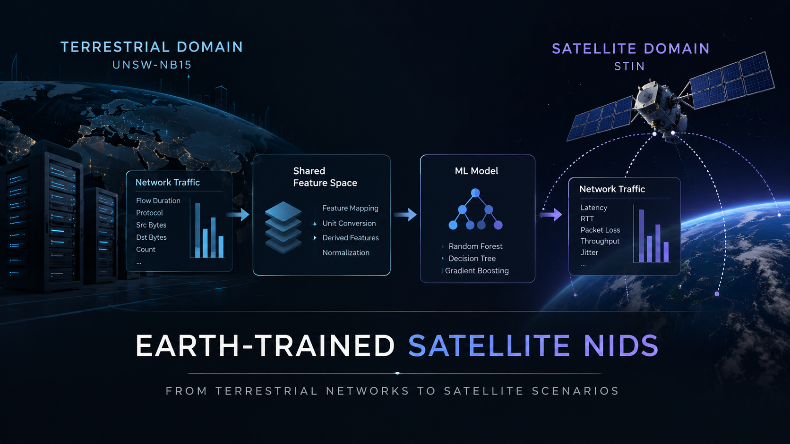

# Earth-Trained Satellite IDS

[](LICENSE) [](#project)



## Project

This project explores whether machine-learning network intrusion detection systems (NIDS) trained on terrestrial traffic can be applied to satellite-network traffic. It provides an experimental pipeline to prepare traffic datasets, train models, evaluate them across domains, and analyse the results.

The project is intended as a starting point for students and researchers interested in cybersecurity, satellite networks, and cross-domain machine learning—especially the challenges of evaluating intrusion detection when satellite traffic data is limited.

For a concise introduction to the problem, methodology, and contributions, see the [project presentation](doc/presentation.pdf). For implementation details, experimental setup, and results, refer to the [thesis](doc/thesis.pdf).

## Repository structure

```text
.
├── main.py                  # Interactive pipeline entry point
├── requirements.txt         # Python dependencies
├── data/
│   ├── raw/                 # Input traffic datasets
│   └── preprocessed/
│       ├── data_for_hybrids_runs/
│       └── data_for_sourceonly_runs/
├── src/                     # Preprocessing, training, evaluation and utilities
│   └── utils/
├── runs/
│   ├── hybrids_archive/     # Split archive parts
│   └── sourceonly_archive/  # Split archive parts
└── doc/
    ├── presentation.pdf     # Project overview
    └── thesis.pdf           # Full project and experiment documentation
```

The folder structure uploaded to this repository is deliberately different from the one generated by running the project. This was done for upload-size limits and to keep the repository organized. Do not assume that the uploaded snapshot folders are the runtime output layout. The steps below explain how to obtain the repository, run the project, and open the stored results.

## Getting started

### Download and run the project

Clone the repository (recommended, as this preserves all parts of the result archives) and enter its folder:

```bash
git clone https://github.com/marchesinia187179/earth-trained-satellite-ids.git
cd earth-trained-satellite-ids
```

Create and activate a Python environment, install the dependencies, and start the interactive application:

```bash
python -m venv .venv
source .venv/bin/activate
python -m pip install -r requirements.txt
python main.py
```

On Windows, activate the environment with `.venv\Scripts\activate` instead. The raw input datasets are in `data/raw/`. From the menu, select preprocessing first for a fresh run, then model building, classification, and statistical analysis; alternatively select the full pipeline. The application creates its runtime output folders as needed. For dataset requirements and the experiment methodology, see the [thesis](doc/thesis.pdf); for an overview of the project, see the [presentation](doc/presentation.pdf).

### Open the stored results

The files in each archive set are volumes of a single archive. Download or clone **all** parts of a set, keep them together in their original folder, and do not rename, move, extract individually, or concatenate the parts. Install [7-Zip](https://www.7-zip.org/) if it is not already available. From the repository root, extract the `.001` volume first; it uses the remaining volumes and produces an intermediate archive. Extract that intermediate archive into a separate folder to restore the results:

```bash
mkdir -p runs/restored/sourceonly_stage1 runs/restored/sourceonly
7z x runs/sourceonly_archive/sourceonly_split.7z.001 -oruns/restored/sourceonly_stage1
7z x runs/restored/sourceonly_stage1/sourceonly.7z -oruns/restored/sourceonly
```

For the hybrid results, use their separate archive parts and destination folders:

```bash
mkdir -p runs/restored/hybrids_stage1 runs/restored/hybrids
7z x runs/hybrids_archive/hybrids_split.7z.001 -oruns/restored/hybrids_stage1
7z x runs/restored/hybrids_stage1/hybrids.7z -oruns/restored/hybrids
```

Keep the original volumes and intermediate archive until extraction has completed and the restored files are present. The separate `runs/restored/` destinations avoid mixing archived results with the uploaded parts or results from a new run. If 7-Zip reports a missing volume, check that every numbered part is present before retrying.

## Continue the project

This repository is a research starting point, open to new questions, datasets, methods, and contributors. New people can help test the assumptions, improve reproducibility, explore additional models, or bring new perspectives to satellite-network security. Keep building on the work and make the project your own.
